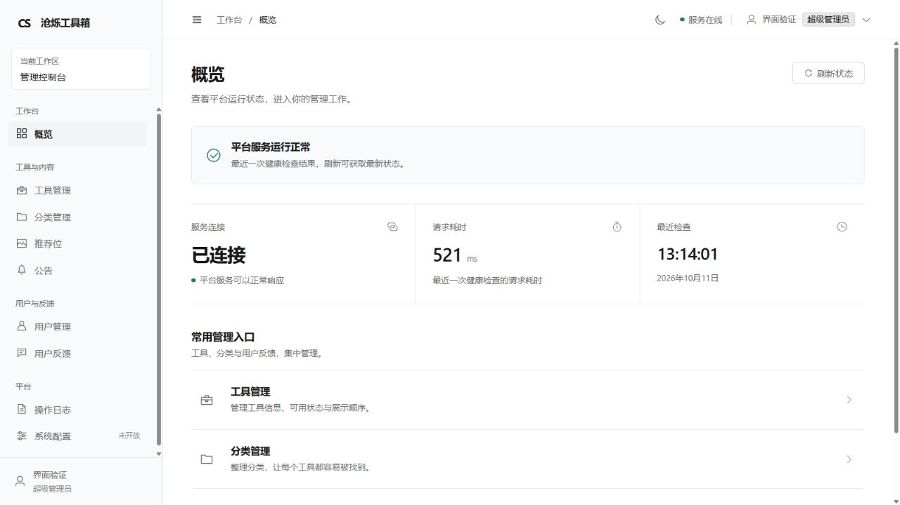
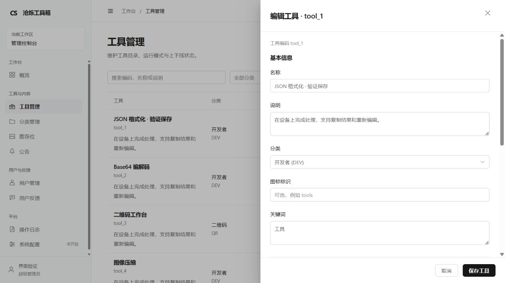
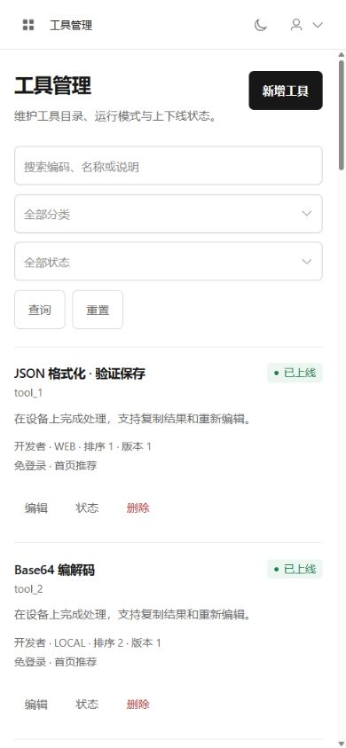

# 管理控制台设计系统

2026-10-11。当前后台采用用户指定的 OpenAI Platform 设计方向，替代早期截图方案的近黑与荧光绿默认主题。实现范围为 `admin/`，保留 Vue 3、TypeScript、Element Plus、Pinia、Vue Router、现有认证和集中 API 契约；没有增加依赖、数据库变更或虚构业务数据。

## 依据与适配

- 视觉参考：[OpenAI Platform](https://platform.openai.com/)，2026-10-11 访问。公开入口显示登录页，未进入其认证后台；官方文档页面的浏览器访问审批超时。本次依据用户提供的详细控制台规范实现，不声称逐页复刻认证界面。
- 源码依据：`src/layouts/AdminLayout.vue`、`router/navigation.ts`、`styles/`、共享页面组件及各业务 `views/`，2026-10-11 查阅。采用统一导航、页头、筛选、数据状态和抽屉；业务操作、危险操作确认和 API 字段沿用原实现。
- 当前系统只有一个管理工作区，展示真实工作区标识；没有增加无法使用的项目切换器。系统配置仍明确标记待开放。概览只显示健康接口连接、耗时和最近检查，不编造人数、趋势或图表。

## 变量与排版

`src/styles/tokens.css` 是颜色、字体、间距、圆角、控件高度和内容宽度的统一入口。`element-plus.css` 将这些语义变量映射到现有组件；`layout.css` 管理框架，`main.css` 与 `pages.css` 管理通用页面。

| 语义 | 浅色值 | 用途 |
| --- | --- | --- |
| `--admin-bg` / `--admin-surface` | `#FFFFFF` | 页面、表格与表单 |
| `--admin-sidebar` / `--admin-raised` | `#F9FAFB` | 导航与次级区域 |
| `--admin-text` | `#171717` | 标题和主要内容 |
| `--admin-secondary` | `#666666` | 说明、表头和次要内容 |
| `--admin-muted` | `#8A8A8A` | 低优先级辅助信息 |
| `--admin-border` | `#E5E7EB` | 分隔线 |
| `--admin-control-border` | `#D1D5DB` | 输入边界 |
| `--admin-hover` / `--admin-selected` | `#F3F4F6` | 悬停和选中 |
| `--admin-accent` | `#171717` | 主要按钮、选中控件 |
| `--admin-focus` | `#737373` | 克制的焦点描边 |
| `--admin-danger` | `#B93838` | 错误和危险操作 |

状态同时使用文字和低饱和度语义色。阴影仅用于浮层；正文依靠留白和细分隔线组织，不使用渐变、发光、玻璃效果或多层悬浮卡片。

字体使用已安装的 Inter 或系统字体；中文回退 PingFang SC / Microsoft YaHei，不从 CDN 下载。页面标题 24px，正文 14px，导航、表格、控件 13px，辅助信息 12px。间距为 4/8/12/16/24/32/40px。圆角分层：按钮、输入与文本域 10px，容器与导航 8px，标签与分页 6px。默认控件高 34px；窄屏（≤639px）与触屏下按钮至少 40px、输入至少 44px。顶栏图标按钮保持正方形，不随窄屏按钮规则拉伸。

## 框架与页面

- 桌面侧栏 232px，折叠 64px，顶部品牌与工作区标识、分组导航、底部账号。图标使用本地 `components/outlineIcons.ts` 单色线性 SVG。
- 顶栏高 56px；主内容独立滚动，导航切换后回到顶部。内容最大宽 1440px，桌面水平留白 40px，中等屏幕 28px，手机 16px。
- 960px 以下导航使用抽屉。640px 以下业务表格改为有分隔线的记录列表；平板表格允许内部水平滚动，页面本身不溢出。
- 页头统一标题、简短说明、右侧操作。概览使用一条状态区与有分隔线的指标带，入口采用平面列表。
- 表格采用白色表头、细行分隔线、小型状态标签和轻量行操作。各页仅提供真实接口支持的搜索、筛选和分页；没有增加无效排序按钮。
- 表单保留原字段、校验与保存逻辑，通过分组标题和分隔线组织。复杂表单使用响应式抽屉，标题和底部操作固定，正文滚动；登录使用居中的简洁表单。

## 组件规范

| 组件 | 当前实现与状态 |
| --- | --- |
| Button | 深色主操作、边框次操作、透明行操作；统一悬停、焦点、禁用、加载；危险按钮使用适度红色 |
| Input / Select | 共用边界、字体和圆角；悬停描边、聚焦细环、错误红边、禁用沿用 Element Plus |
| Checkbox / Switch | 深色选中、灰色关闭、明确焦点；业务状态及确认逻辑不变 |
| Tabs | 灰色文字与细下划线；反馈状态沿用现有可操作筛选控件 |
| Table / Pagination | 统一单元格留白、表头、行分隔线与当前页；保留各页分页逻辑 |
| Badge | `AdminStatusTag` 小型状态标签，文字与语义色同时表达状态 |
| Dropdown / Tooltip | 细边框、适度阴影、统一字体与悬停背景；本地 Element Plus 实现 |
| Dialog | 统一尺寸、边框及主次按钮；保留编码确认、发布和用户停用限制 |
| Toast | 统一语义背景、文字与轻量边框；成功/错误反馈沿用现有调用 |
| Empty / Loading | `AdminDataPanel` 与简洁空文案；加载保留上次结果、禁用操作、失败可重试 |

新页面应优先复用 `AdminPageHeader`、`AdminFilterBar`、`AdminDataPanel`、`AdminStatusTag`、`AdminRecordCards`、`AdminDetailDrawer` 与 `AdminFormError`。不要复制颜色、字体或重复构造表单抽屉。

默认主题为浅色。独立启动脚本与 Pinia 使用相同默认值，存储失败或无效配置时回退浅色；用户已经明确保存的深色偏好保留。可通过顶栏主题按钮切换，选择只影响后台 UI。

## 本轮实际验证

- 生产 `/admin/` 构建及 TypeScript 检查通过，正式 API 地址为 `https://toolapi.zhzgo.cn/api/v1`。
- 主题偏好回归通过；反馈状态检查 14/14、最新请求归属检查 4/4 通过。
- 使用仅监听本机的隔离内存 HTTP 示例接口，经普通登录进入实际 App/路由；没有访问真实业务数据库。示例数据与账号不打包、不上线，截图中的记录为示例。
- 1280px：概览、各业务表格加载成功；工具编辑保存、分组表单、固定操作栏、删除确认取消、主题切换和侧栏折叠可用。
- 工具分页到第 2 页显示剩余 3 条；搜索无数据显示说明；模拟 503 显示错误和请求标识，重置恢复；反馈状态与回复保存后列表更新。
- 1024px / 768px：框架不溢出，平板表格在自身区域滚动。390px / 320px：手机导航、列表与表单可用，320px 下逐页检查概览、工具、分类、推荐位、公告、用户、反馈、日志、配置占位页，无页面横向溢出。
- 2026-10-11 复核：窄屏按钮由 44px 收紧到 40px、圆角由 6px 提高到 10px，顶栏图标恢复 32×32 正方形；423/574px 实测推荐位、工具、概览、反馈页与编辑抽屉显示正常。
- 本次浏览器最终警告/错误记录为空。没有做真实生产数据库 CRUD、全网络异常矩阵、200% 缩放或完整键盘/屏幕阅读器/对比度审计；这些仍为独立验收任务。

生产发布、文件校验与回退结果见 [2026-10-11 部署记录](ADMIN_UI_DEPLOY_2026-10-11.md)。
