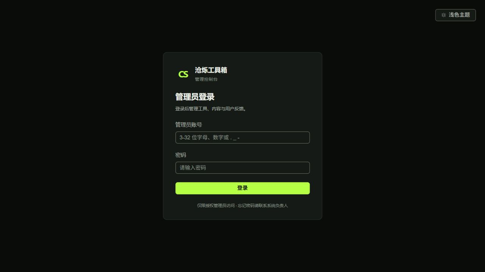

# 管理后台 UI 正式部署记录

2026-10-11，按用户要求，通过已登录的宝塔面板部署当前工作区的后台 UI。

## 发布范围与位置

- 线上入口：<https://tool.zhzgo.cn/admin/login>。
- 构建参数：`VITE_APP_BASE_PATH=/admin/`，`VITE_API_BASE_URL=https://toolapi.zhzgo.cn/api/v1`，与服务器公开域名配置一致。
- 服务器项目：`/www/wwwroot/cangshuo-toolbox`，实际运行方式为宝塔 Nginx → 本机 18080 → Docker Admin 容器。
- 发布包包含 40 个生产文件和 57 个后台源码/配置文件；不包含 node_modules、环境密钥、Android 或服务端代码。
- 本地发布包、清单和校验文件：`D:\codeStudy\code\cangshuo-tool\deploy\release-state\admin-ui-20261011\`。该目录已被仓库忽略。
- 发布包 SHA-256：`81f624c0cefe3bb4ab7ac79669a9ac96adc04b046d136d9871a1e75998b08765`。

当前 UI 尚未提交到 Git，因此本次通过上传发布包更新；没有用 `git pull` 替代当前工作区成果。

## 备份与发布

服务器备份目录为 `/www/wwwroot/cangshuo-toolbox/deploy/release-state/admin-ui-20261011/`，目录权限 700。其中保留旧后台静态文件、`admin-source-before.tar.gz`（权限 600）及旧镜像编号。

旧镜像额外保留为 `cangshuo-toolbox-production-web:ui-backup-20261011`。新镜像 `cangshuo-toolbox-production-web:ui-20261011` 以该旧镜像为基础，仅覆盖 `/usr/share/nginx/html/admin/`，保留原官网与 Nginx 配置；旧哈希资源也保留，供发布前已经打开的页面继续读取。上传后的后台源码同步到服务器项目，供后续常规构建使用。

校验新镜像的 index.html 后，将新镜像标记为 Compose 当前使用的 `cangshuo-toolbox-production-web:0.1.0`，执行 `up -d --no-deps --no-build --force-recreate --wait --wait-timeout 60 admin`。只有后台容器被替换，启动命令带旧镜像恢复分支；本次新容器正常启动，该分支未执行。服务端、MySQL、Redis 保持原容器运行。

## 实际验证

- 本地 TypeScript 检查和生产构建通过；主题偏好检查、反馈状态 14/14 和最新请求归属 4/4 回归通过。
- 上传包 SHA-256、新镜像 index.html 校验通过。
- 服务器 57 个后台源文件及运行容器中的 40 个生产文件逐一 SHA-256 校验通过；结果保存在备份目录的 `source-verify.txt`、`dist-verify.txt`。
- 新后台容器为 running / healthy；API、MySQL、Redis 同样为 healthy，运行时长表明它们未被重新创建。
- 公网 HTTPS 的 `/admin/login`、`/admin/tools`、`/admin/theme-init.js`、本次入口 JS 和 CSS 均返回 200；公网及内部代理 API health 均返回 `status=UP`。HTTPS 检查未跳过证书验证。
- 浏览器通过公网地址显示新版深色登录页，警告/错误记录为空。截图见下方。
- 线上登录页响应含 `Cache-Control: no-store` 与 `no-cache`；入口 JS 在宝塔边缘返回 `max-age=60`，不将容器内的缓存规则当作公网实际规则。

服务器没有 `python3`；最初的源文件校验未执行，随后改用服务器和容器已有的 `sha256sum`，完成上述逐文件校验，没有安装额外运行时。

本次未进入管理员账号，也未在生产数据库执行 CRUD。真实登录/权限/会话到期、完整网络异常矩阵、200% 缩放和无障碍验收仍保留为路线图任务。



## 回退方法

恢复旧后台镜像；不更改数据库或环境密钥：

```sh
cd /www/wwwroot/cangshuo-toolbox/deploy
docker tag cangshuo-toolbox-production-web:ui-backup-20261011 cangshuo-toolbox-production-web:0.1.0
docker compose --env-file ../.env.production -f docker-compose.yml -f docker-compose.baota.yml up -d --no-deps --no-build --force-recreate --wait --wait-timeout 60 admin
```

如还需恢复服务器后台源码，先保存当前源码再解开旧备份，避免丢失新增文件：

```sh
cd /www/wwwroot/cangshuo-toolbox/deploy
test ! -e release-state/admin-ui-20261011/admin-source-after-rollback && \
  mv ../admin release-state/admin-ui-20261011/admin-source-after-rollback && \
  tar -xzf release-state/admin-ui-20261011/admin-source-before.tar.gz -C ..
```

回退后重新检查容器健康、API health 和线上页面。以上回退方法已记录，本次没有执行生产回退演练。
